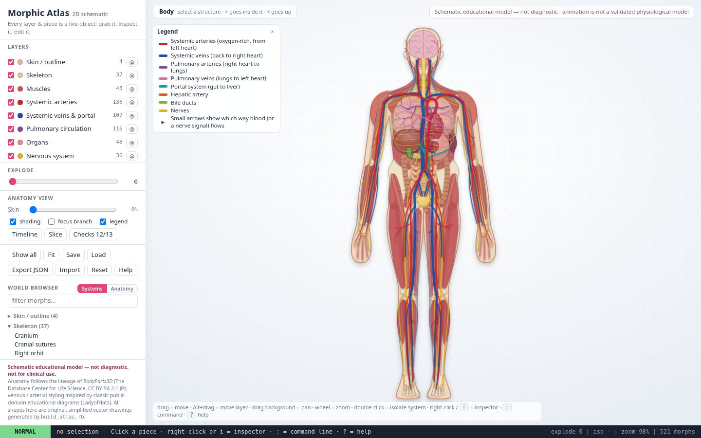
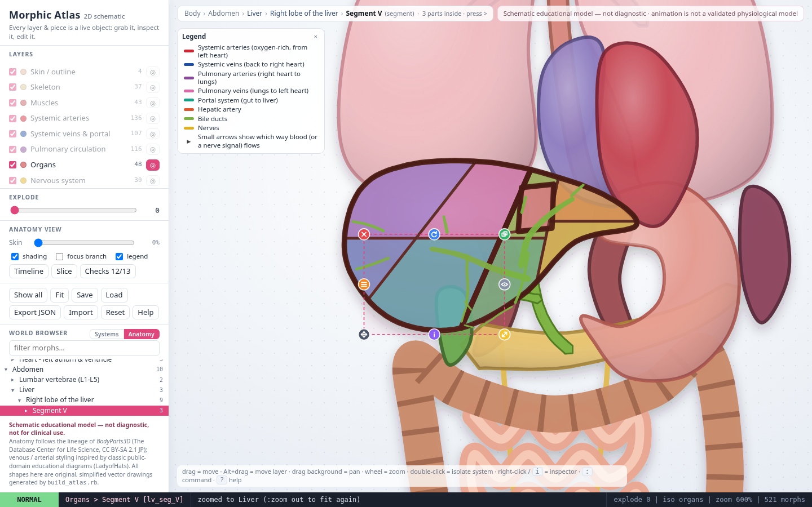
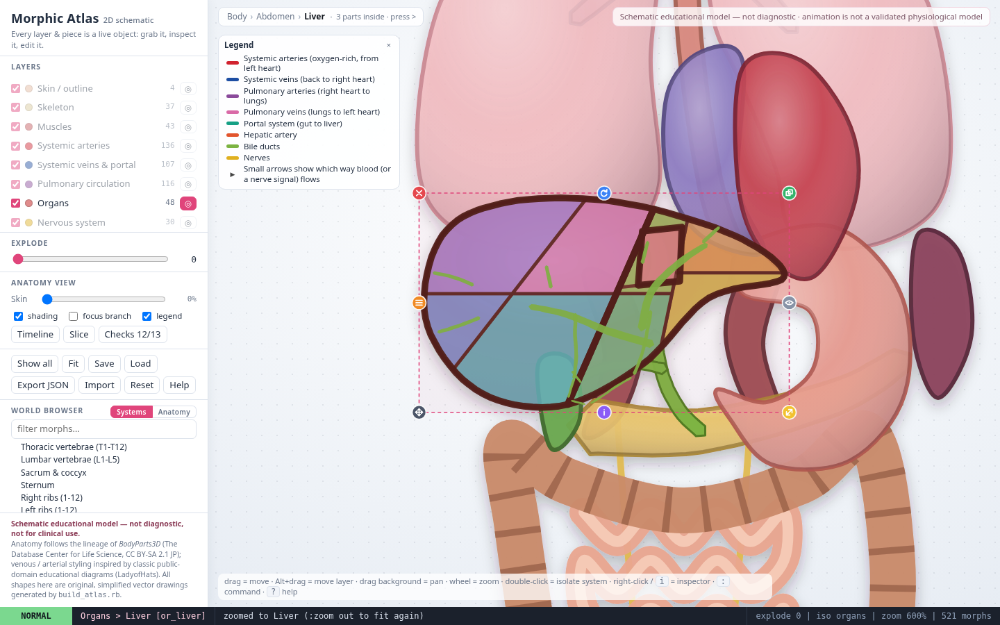
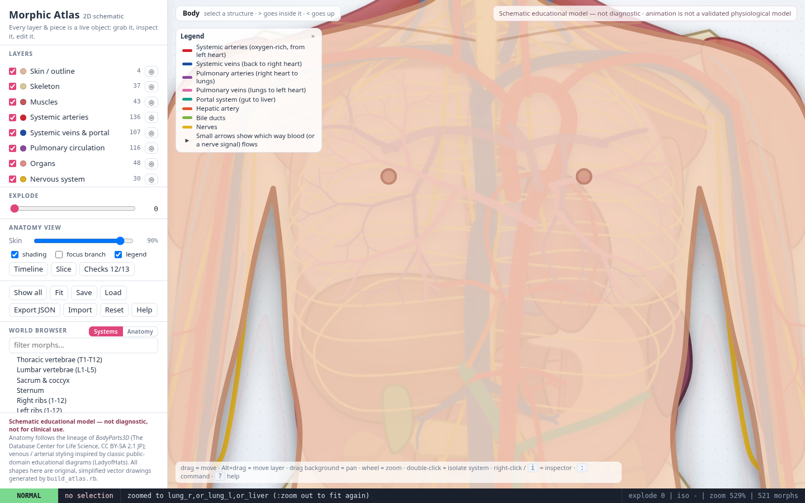
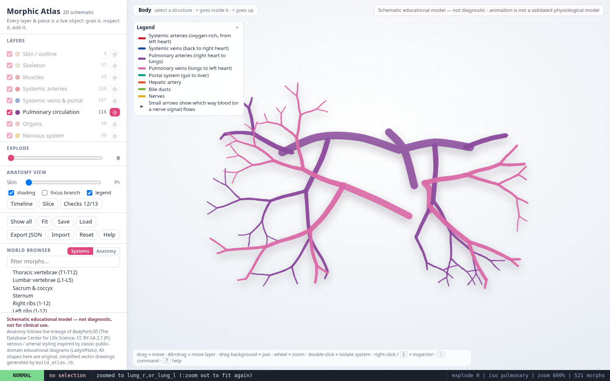
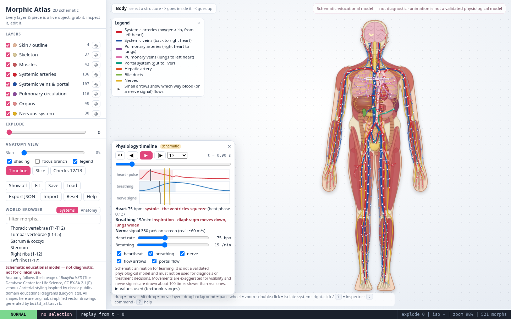
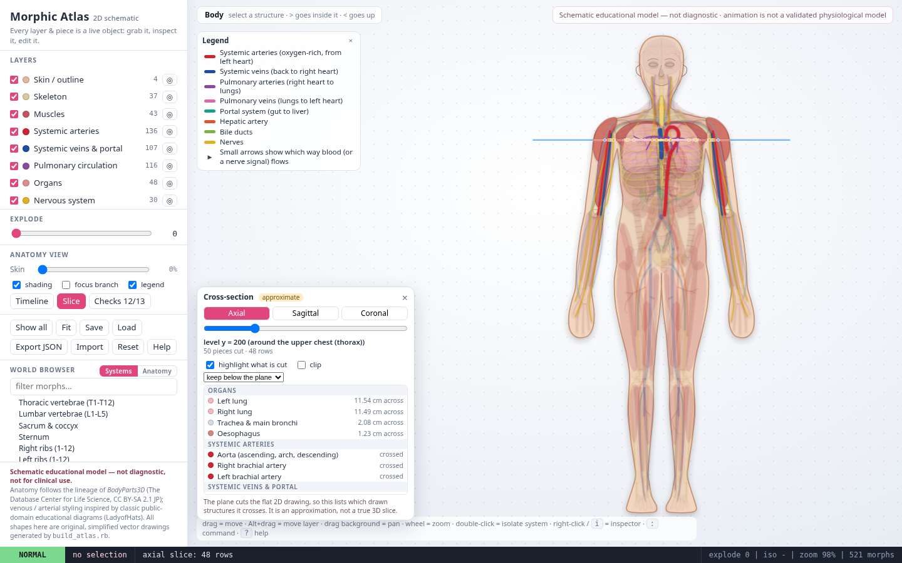
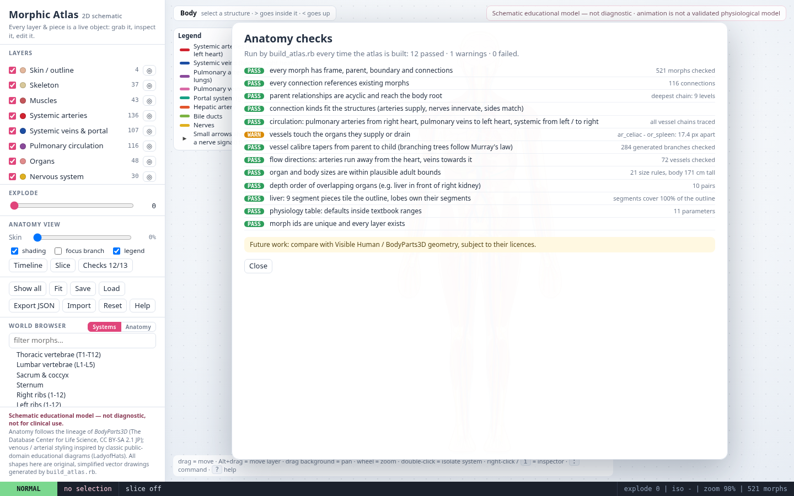
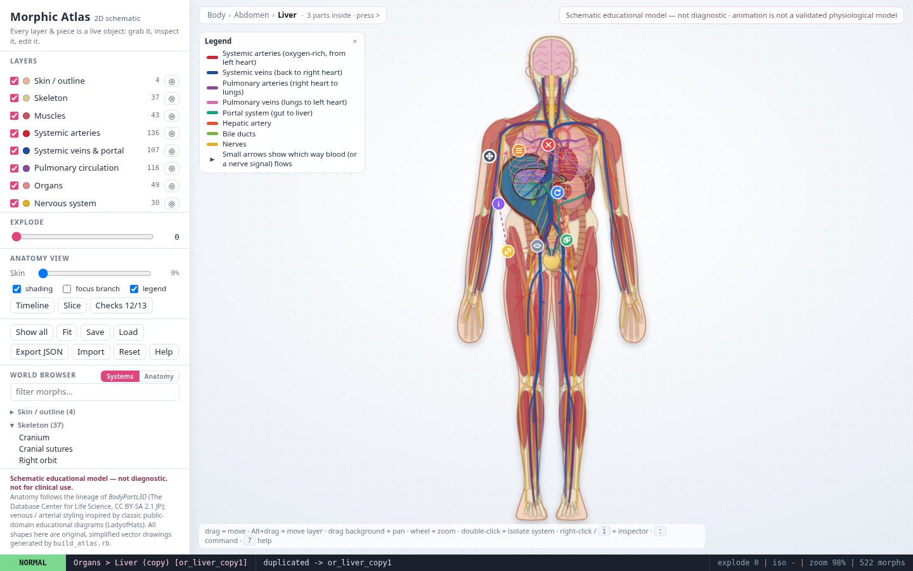
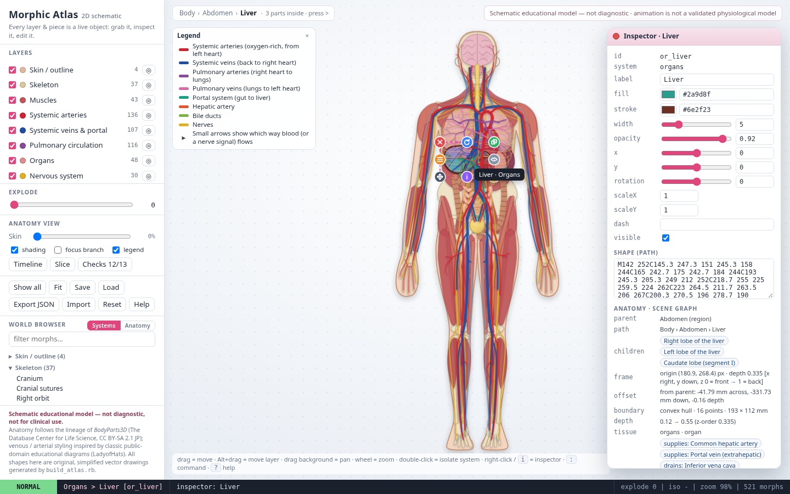

# Morphic Atlas

**[Open the live atlas](https://ahmadaliparr.github.io/morphic-atlas/)** — it runs right in your browser, no install.

A 2D picture of the human body that you can pick apart with your mouse and your keyboard.
Every organ, bone, muscle, vessel and nerve is a small live object. You can click it, drag it,
open it up to see what it is made of, and change it while the atlas is running.

The whole atlas is **one file**: `atlas.html`. Open it in any modern browser. It needs no
internet and no install.



## What it is for

It is a teaching sketch, not a medical tool. The shapes are simplified drawings, the sizes are
rounded adult values, and the movement is exaggerated so you can see it. Please do not use it
to diagnose or plan anything.

## Opening it

Double-click `atlas.html`. That is all.

To rebuild it from the source (you need Ruby 3, nothing else):

```
ruby build_atlas.rb
```

This writes a fresh `atlas.html` and prints an anatomy check report (see "The anatomy checks"
below). Building twice gives exactly the same file.

## How the body is organised

Every piece of the body knows four things about itself:

* **where it sits**: its own centre point and distance from the front of the body,
* **its outline**: the shape it fills,
* **what it belongs to**: its parent (a lobe belongs to the liver, the liver belongs to the abdomen),
* **what it touches**: the vessels that feed it, the nerves that reach it, the organs next to it.

You can see all of this for any piece in the Inspector (right-click a piece, or press `i`), and as a
tree in the **World browser** on the left (switch it to the **Anatomy** tab).

**Going inside.** Select the liver and press `>` to step into its lobes, press `>` again to reach a
segment, and so on. Press `<` to step back out. The bar at the top shows where you are
(*Body › Abdomen › Liver › Right lobe of the liver › Segment V*).



## Seeing inside an organ

The inner parts of an organ stay out of sight until you select the organ. For the liver you then see:

* the three lobes and the nine segment pieces,
* the hepatic artery, the portal vein, the three hepatic veins,
* the bile ducts.



## In front and behind

Organs have a depth, so they overlap the way they do in a body. The liver sits in front of the
right kidney, the heart in front of the spine, and so on. Soft shading gives each organ a gentle
sense of roundness. The **Skin** slider on the left turns the skin from clear to nearly opaque so you
can see how much it hides.



## Blood vessels

Vessels branch into smaller and smaller twigs, and each twig is thinner than the one it came from.
The branching is made by the Ruby program with a fixed seed, so you get the same tree each time.

* red: arteries that carry blood away from the left heart,
* blue: veins that bring blood back to the right heart,
* purple and pink: the lung circuit (arteries from the right heart, veins back to the left heart),
* green: the portal vein carrying blood from the gut to the liver.

The legend in the corner shows the colours. Click a legend row to light up that kind of vessel.



## Things that move

Press `T` (or click **Timeline**) to open the timeline. Press `Space` to play and pause, `.` and `,` to
step one frame forward or back, and `:replay` to start again.

* **The heartbeat**: the heart squeezes and relaxes, a pulse runs down the vessels, and small arrows
  show which way the blood goes.
* **Breathing**: the diaphragm moves down and the lungs widen as you breathe in.
* **A nerve signal**: a bright packet travels along a nerve path.
* **Portal flow**: blood moves from the gut towards the liver.

The numbers behind it (resting heart rate 60 to 100 beats a minute, 12 to 20 breaths a minute, and
so on) sit in one table in the Ruby source, `dev/06_physiology.rb`, with a note on where they come
from: ordinary physiology textbook ranges.

**This is a drawing that moves, not a simulation.** It is meant to help you picture what happens.
It is not a validated physiological model and should not be used to predict how a real body behaves.
The movements are enlarged so you can see them, and the nerve signal is drawn about a hundred times
slower than a real one.



## Cutting the body

Press `Z` (or **Slice**) to place a flat cutting plane through the picture: across (axial), from
side to side (sagittal) or front to back (coronal). The side panel lists every structure the plane
crosses, and everything else fades back. `:slice axial 200` puts the plane at chest height.

This works on the flat drawing, so it tells you which drawn structures the plane touches. It is a
good guide, not a real scan slice.



## The anatomy checks

Each time `build_atlas.rb` runs it checks its own data and prints a report. It makes sure that:

* every connection points at a piece that exists,
* arteries, veins and nerves join the organs they should,
* the parent chain never loops,
* organ sizes are believable for an adult,
* vessels get thinner as they branch,
* blood flows away from the heart in arteries and back towards it in veins,
* the liver is in front of the right kidney,
* the nine liver segments fill the liver outline,
* the physiology table stays inside textbook ranges.

At the moment 12 checks pass and one gives a gentle warning (the artery to the spleen is not drawn, so
the celiac artery ends a little short of it). The report is also in the page: click **Checks** on the left.



**Next step for the anatomy:** compare the shapes with real reference geometry such as the Visible Human
and BodyParts3D data. That needs a look at their licences first, so it is not done here.

## The Morphic part

The look and feel come from Morphic, the direct-manipulation interface of Self and Squeak.

* **Drag** a piece to move it. **Alt-drag** moves a whole layer. Drag the background to pan; scroll to zoom.
* **Halo**: click a piece and small round handles appear around it for delete, rotate, resize,
  duplicate and more.
* **Inspector**: right-click, or press `i`. Edit colour, line width and position and watch the piece
  change at once. The evaluator at the bottom lets you type a line of code against the piece.
* **Explode** slider and layer list on the left spread the body apart or hide whole systems.
* **Save / Load / Export / Import / Reset** keep your changes in the browser or in a JSON file.




### What "Self-style" means here

The objects in this page follow the way Self works: every piece is a prototype object with named
slots you can read and change, and a new piece is made by copying an existing one. That is the whole
idea borrowed from Self. **This is not the real Self virtual machine.** There is no Self code in the
page; it is ordinary JavaScript written in that style.

Ruby is the anatomy and physiology core: it holds all the body data, grows the vessel trees, runs
the checks, and writes the single `atlas.html`.

## Vim keys

Press `Esc` for normal mode. A few favourites:

| Keys | What they do |
|---|---|
| `h j k l` | nudge the selected piece |
| `w` / `b` | next / previous piece |
| `>` / `<` | step into / out of the selected piece |
| `Tab` / `Shift-Tab` | next / previous sibling at the same level |
| `L` | next layer |
| `x`, `dd`, `yy`, `u` | hide, delete, duplicate, undo |
| `e` | explode on / off |
| `T`, `Space`, `.`, `,` | timeline: open, play or pause, step forward, step back |
| `Z` | cross-section plane: axial, sagittal, coronal, off |
| `(` / `)` | skin more clear / more opaque |
| `:` | command line |
| `?` | help |

Useful commands: `:iso arteries`, `:show all`, `:explode 40`, `:zoom` (zoom to the selection), `:zoom out`,
`:children`, `:path`, `:skin 0.6`, `:hr 75`, `:rr 15`, `:slice axial 200`, `:validate`, `:save`, `:load`, `:reset`.

## Files

| Path | What it is |
|---|---|
| `atlas.html` | the finished atlas (one file) |
| `build_atlas.rb` | the Ruby program that makes it, and checks the anatomy |
| `dev/` | the readable source pieces that `dev/assemble.sh` joins into `build_atlas.rb`, and the check scripts |
| `docs/img/` | the pictures in this README |
| `shots/` | screenshots taken by the check scripts |

To change the anatomy, edit the Ruby pieces in `dev/`, then run `dev/assemble.sh` and `ruby build_atlas.rb`.

## Checking it

`dev/verify.sh` rebuilds the atlas and then drives it in a headless Chrome (using `puppeteer-core`)
through about eighty small tests: dragging, the halo, the Inspector, the Vim keys, saving and loading,
drill-down, liver internals, skin opacity, the timeline, slices and the report. It takes screenshots
into `shots/` as it goes.
